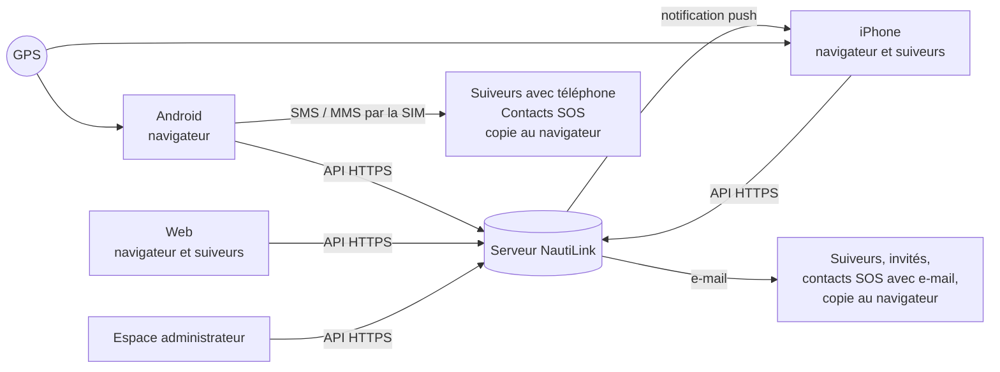

# NautiLink — Cahier des charges fonctionnel

*Your sea, your safety, your story.*

Ce document décrit le périmètre et les fonctionnalités, écran par écran. Les règles détaillées (calculs, cas limites, contenus des messages) sont dans [02-regles-metier.md](02-regles-metier.md) et ne sont pas répétées ici : on y renvoie par identifiant `RG-…`. Vocabulaire : [00-glossaire.md](00-glossaire.md).

## 1. Présentation

NautiLink est une solution connectée pour les plaisanciers et leurs proches. Elle permet de partager sa position en mer, de transmettre des informations pendant une navigation, de déclencher une alerte SOS et de conserver un journal de bord consultable sur le Web.

Elle comprend :

- **NautiLink Android** : l'application du navigateur à bord (démarrage et fin de navigation, positions, journal de bord, SOS par SMS et par Internet) ;
- **NautiLink iPhone** : les mêmes fonctions sans aucun SMS, plus le suivi des navigations avec notifications push (§5.6) ;
- **NautiLink Web** : la plateforme de consultation, de suivi et de gestion (navigations, journaux, bateaux, suiveurs, paramètres, abonnement) ;
- **le serveur NautiLink** : API HTTPS, stockage, calcul du quota, envoi des e-mails ;
- **l'espace administrateur** : application Web distincte réservée à l'équipe NautiLink.

## 2. Objectifs

1. Permettre au navigateur de démarrer et terminer une navigation.
2. Enregistrer et transmettre régulièrement sa position, et à la demande.
3. Transmettre des notes écrites, des photos et des notes vocales.
4. Déclencher une alerte SOS fiable, même sans Internet.
5. Permettre aux proches autorisés de suivre une navigation en temps réel.
6. Conserver toutes les informations dans un journal de bord.
7. Consulter et gérer les navigations depuis le Web.

## 3. Périmètre

**Inclus** : application Android, plateforme Web, application iPhone (construite après l'application Android et le Web), espace administrateur, interfaces en français et en anglais (RG-PRM-03), thème clair et thème sombre, offre gratuite et abonnement.

**Exclus au lancement** :

- carte affichée sur l'écran de navigation de l'application mobile (RG-NAV-09) ;
- envoi de SMS depuis un iPhone (RG-IOS-02) ;
- prestataire d'envoi de SMS : les SMS partent de la carte SIM du téléphone (RG-COM-01) ;
- accès anonyme aux navigations (RG-PAR-01) ;
- gestion de plusieurs versions de l'application Web (RG-ADM-05) ;
- autres langues que le français et l'anglais.

Les évolutions futures sont listées au §9.

## 4. Architecture générale

- Hébergement pendant la bêta : un seul serveur, en Go, sur un Raspberry Pi sous pi-appliance, à l'adresse `https://nautilink.moulard.org` ([D-62](07-decisions.md#d-62)).
- Le circuit Internet et le circuit SMS sont indépendants ; le GPS ne dépend d'aucun des deux (RG-COM-01, RG-COM-02, RG-GPS-01).
- L'application mobile stocke localement positions, événements, paramètres et contacts, et les synchronise dès que possible (RG-GPS-03, RG-GPS-04, RG-PRM-02, RG-CTC-03).
- Le serveur est la référence pour les paramètres, les accès et le quota (RG-PRM-01, RG-ECO-09).
- Architecture technique (serveur, base, fichiers, e-mails, notifications push) : [08-architecture.md](08-architecture.md).

## 5. Applications mobiles

Les §5.1 à §5.5 décrivent l'application Android ; l'application iPhone est identique, sauf ce que dit le §5.6.

### 5.1 Connexion

Connexion par e-mail et mot de passe, Google ou Apple (RG-CPT-02, RG-CPT-11) ; « Mot de passe oublié ? » (RG-CPT-10). À la création du compte, acceptation de l'avertissement bêta (RG-CPT-06) et confirmation de l'adresse e-mail, exigée pour démarrer une navigation et pour inviter (RG-CPT-09) ; mention « Version bêta » visible tant que dure la bêta (RG-CPT-07) ; rappel avant le premier démarrage d'une navigation sur le téléphone (RG-NAV-23). Association du téléphone au bateau (RG-BAT-02) ; téléphone repris par un autre compte (RG-BAT-04).

### 5.2 Écran d'accueil

Trois boutons :

- **Démarrer navigation** ;
- **Reprendre la dernière navigation** : ouvre l'écran de la navigation en cours (RG-NAV-12) ;
- **Navigations enregistrées** : liste récupérée depuis le serveur ; la sélection ouvre la page de la navigation sur la plateforme Web.

L'accueil affiche aussi le bouton rouge **Envoyer un SOS** (RG-SOS-15).

L'accueil donne aussi accès aux paramètres généraux, aux contacts (suiveurs et contacts SOS), au quota et à l'abonnement, à l'historique des alertes SOS et à l'assistance.

### 5.3 Écran de démarrage

- choix du bateau, s'il y en a plusieurs (RG-NAV-02) ;
- destination facultative, en texte ou sur une carte (RG-NAV-04) ;
- nombre de personnes à bord (RG-NAV-27) ;
- personnes alertées, toutes cochées, et « Ajouter une personne » (RG-NAV-25, RG-NAV-26) ;
- fréquence préremplie : de 15 minutes à 10 jours (RG-NAV-05) ;
- bouton **Paramètres** pour adapter les réglages à cette navigation (RG-NAV-06) ;
- bouton **Envoi message – Début de navigation** (RG-NAV-08).

Si le quota est épuisé sans abonnement, le démarrage est refusé avec l'explication et les choix possibles (RG-ECO-04).

### 5.4 Écran de navigation en cours

- deux chronomètres : depuis le début, depuis le dernier envoi (RG-NAV-10) ;
- **Envoyer information position** : position manuelle, SMS si prévu, envoi au serveur, résultat affiché (RG-COM-03, RG-SMS-04) ;
- **NOTE** : note écrite ;
- **Photo** : prise ou sélection d'une photo (RG-SMS-05) ;
- **Vocal** : enregistrement de la voix, sans transcription (RG-JRN-04, RG-SMS-06) ;
- **Envoyer un SOS** : bouton rouge, confirmation (RG-SOS-01 à RG-SOS-14) ;
- **Terminer la navigation** : confirmation puis clôture (RG-NAV-13, RG-NAV-14).

Chaque note, photo et note vocale est enregistrée dans le journal et transmise selon les paramètres de la navigation. Aucune carte n'est affichée (RG-NAV-09).

### 5.5 Autres écrans

- **Paramètres généraux** (RG-PRM-01, RG-SMS-02) ;
- **Contacts** : liste unique, cases « Suiveur » et « Contact SOS », invitations, périmètre, retrait (RG-CTC-01 à RG-CTC-05, RG-PAR-02 à RG-PAR-06) ;
- **Quota et abonnement**, souscription Google Play (RG-ECO-07, RG-ECO-09) ;
- **Historique des alertes SOS** (RG-SOS-13) ;
- **Assistance** : contact de l'équipe NautiLink.

### 5.6 Particularités de l'iPhone

- Aucun SMS ni MMS : ni positions, ni notes, ni SOS, ni invitations par SMS (RG-IOS-02). Les réglages SMS sont sans effet et l'écran de démarrage le dit.
- SOS par Internet uniquement : alerte au serveur, e-mails, notifications push ; sans Internet, envoi dès le retour de la connexion (RG-IOS-03). Avertissement au démarrage (RG-IOS-04).
- Invitation par téléphone : le lien s'affiche, le navigateur le transmet lui-même (RG-PAR-04).
- Rôle suiveur : tableau de bord et page de navigation comme sur le Web, avec la carte (RG-IOS-05) ; notifications push (RG-IOS-06).
- Abonnement par achat intégré de l'App Store (RG-IOS-07).

## 6. Plateforme Web

### 6.1 Tableau de bord

Page d'accueil après connexion ([D-23](07-decisions.md#d-23)) :

- en haut, les navigations **en cours** : les miennes et celles que je suis ;
- en dessous, l'**historique**, de la plus récente à la plus ancienne, filtrable « comme navigateur » / « comme suiveur » ;
- pour chaque navigation : nom, bateau, date et heure de départ, lieu de départ, lieu d'arrivée, durée, distance (RG-NAV-16) ;
- prévisualisation au survol sur ordinateur, au toucher sur mobile.

### 6.2 Page d'une navigation

- informations générales et fiche du bateau (RG-NAV-16, RG-PAR-08) ;
- export PDF, pour le navigateur et les suiveurs (RG-NAV-19) ;
- carte : dernière position, positions successives, tracé, dates et heures, événements ;
- journal de bord chronologique avec photos et notes vocales lisibles (RG-JRN-02, RG-JRN-03) ;
- alertes SOS de la navigation ;
- pour le navigateur seulement : renommer et modifier destination, bateau et heures (RG-NAV-17, RG-NAV-22), ajouter et modifier des éléments du journal (RG-JRN-05, RG-JRN-06), supprimer (RG-NAV-20), gérer les suiveurs de la navigation.

Pendant une navigation en cours, la page se met à jour à mesure que les positions arrivent sur le serveur.

### 6.3 Gestion du compte

- **Bateaux** : création et modification des fiches (RG-BAT-01), téléphone associé (RG-BAT-02) ;
- **Contacts** : liste unique, cases « Suiveur » et « Contact SOS », invitations, périmètre, retrait (RG-CTC-01 à RG-CTC-05, RG-PAR-02 à RG-PAR-06) ;
- **Paramètres généraux** (RG-PRM-01) ;
- **Quota et abonnement**, souscription Web (RG-ECO-07, RG-ECO-09) ;
- **Corbeille** : navigations supprimées, restauration (RG-NAV-20) ;
- **Historique des alertes SOS** (RG-SOS-13) ;
- **Assistance**.

### 6.4 Côté suiveur

Le suiveur voit sur son tableau de bord les navigations auxquelles il a accès et les consulte en lecture seule ; il voit aussi la fiche du bateau, les autres suiveurs et les contacts SOS, et peut exporter en PDF (RG-PAR-07, RG-PAR-08). Le suivi est gratuit (RG-ECO-08).

## 7. Espace administrateur

Fonctions au lancement : RG-ADM-01 à RG-ADM-04. Profils d'administrateurs et traçabilité : [D-47](07-decisions.md#d-47).

## 8. Exigences transverses

- **Fiabilité** : le SOS et l'enregistrement des positions fonctionnent sans Internet (RG-GPS-01, RG-SOS-05) ; aucune étape d'une transmission n'en bloque une autre (RG-COM-02).
- **Ergonomie à bord** : gros boutons, bonne lisibilité, confirmation avant le SOS et la fin de navigation, résultat de chaque transmission affiché, distinction nette entre navigation et suivi.
- **Interface** : identité visuelle de [05-identite-marque.md](05-identite-marque.md), thème clair et thème sombre, français et anglais (RG-PRM-03), accessibilité WCAG 2.2 niveau AA (RG-PRM-05).
- **Sécurité** : API HTTPS ; les accès respectent les droits donnés par le navigateur ; un retrait d'accès empêche toute consultation ultérieure (RG-PAR-06). Le reste : [D-45](07-decisions.md#d-45).
- **Conservation** : RG-DON-01, RG-DON-02.

## 9. Évolutions futures

Hors lancement, sans engagement :

- cartes marines du SHOM sur le Web ([Q-23](06-questions-ouvertes.md#q-23)) ;
- autres langues ([Q-27](06-questions-ouvertes.md#q-27)) ;
- plusieurs versions de l'application Web ([Q-28](06-questions-ouvertes.md#q-28)).
