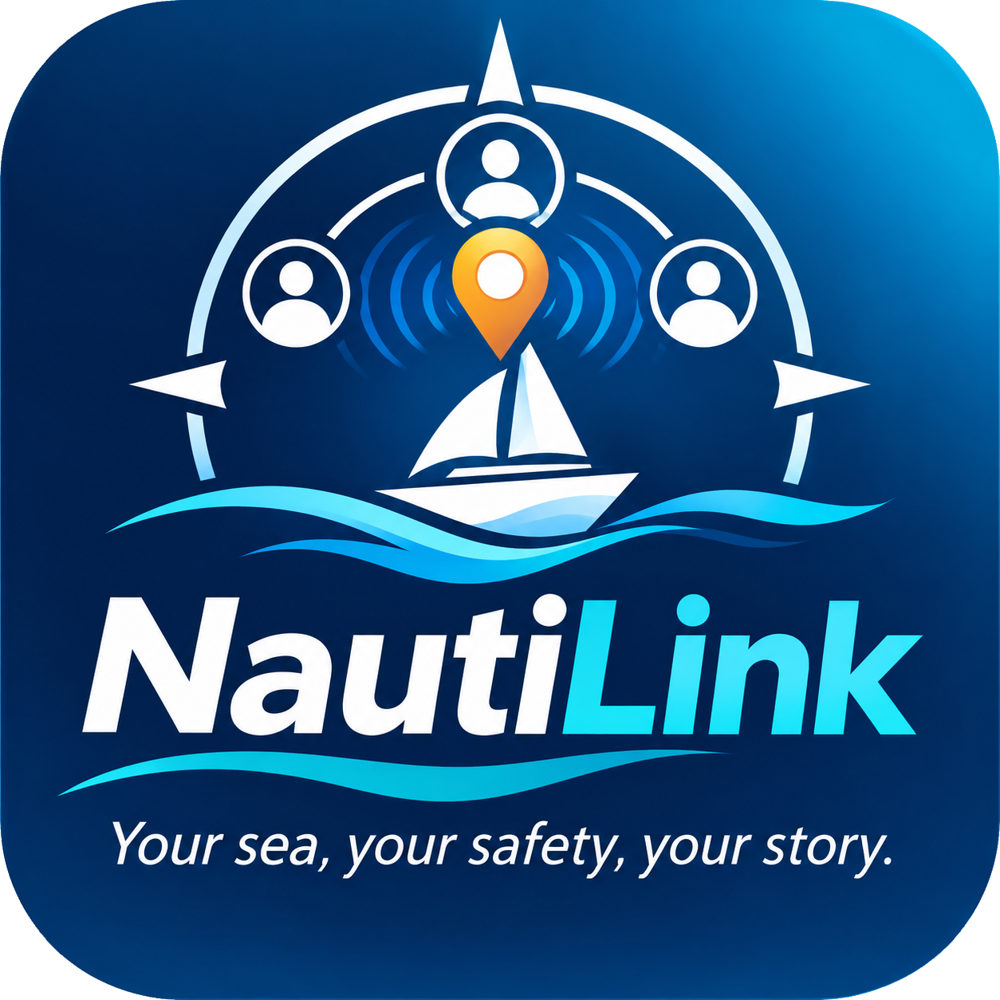

# NautiLink — Identité de marque et charte graphique

Statut : identité définie, logo validé avec son repère GPS orange ([D-98](07-decisions.md#d-98)) ; fichiers vectoriels, icônes et déclinaisons validés ([D-117](07-decisions.md#d-117), §5.5).

*Logo validé ([D-98](07-decisions.md#d-98)) : [assets/logo-nautilink.png](assets/logo-nautilink.png) (image d'origine) ; fichiers vectoriels et déclinaisons : §5.5.*

## 1. La marque

NautiLink est une marque de navigation de plaisance, de partage de position et de sécurité. Elle représente le lien entre le navigateur, son bateau, sa position en mer, et ses proches qui suivent sa navigation.

Elle doit inspirer confiance, simplicité, modernité et sérénité.

## 2. Nom

**NautiLink** : *Nauti* (l'univers nautique) + *Link* (le lien, le partage). Toujours écrit NautiLink, avec N et L majuscules.

## 3. Signature

**Your sea, your safety, your story.**

- *Your sea* : la liberté de naviguer.
- *Your safety* : la sécurité et le partage de position avec les proches.
- *Your story* : la mémoire des navigations et le journal de bord.

La signature reste en anglais, y compris dans les supports en français.

## 4. Positionnement

NautiLink est le compagnon connecté du navigateur : navigation de plaisance, partage de position, lien avec les proches, sécurité, suivi des navigations, journal de bord numérique.

NautiLink ne se présente pas comme une simple application GPS ou de cartographie. Sa valeur est de rapprocher le navigateur de ceux qui comptent pour lui, tout en gardant une trace de ses navigations.

## 5. Logo

### 5.1 Idée

*Plusieurs personnes peuvent savoir où tu es.* Le bateau et le navigateur sont au centre ; autour, les proches qui suivent sa position.

### 5.2 Éléments

Un bateau (le navigateur), un repère GPS (sa position), plusieurs silhouettes (les amis), des ondes ou lignes de connexion (le partage). Éviter un voilier ou une boussole seuls, qui ne traduisent pas le partage.

### 5.3 Style

Moderne, simple, reconnaissable, lisible en petit, adapté à une icône Android et iPhone et au Web, lisible sur fond clair comme sur fond sombre.

### 5.4 Déclinaisons à produire

1. Logo complet : symbole et nom.
2. Version avec la signature.
3. Symbole seul pour les icônes Android et iPhone.
4. Version monochrome.
5. Version pour fond sombre.
6. Version pour fond clair.

### 5.5 Fichiers

Dans [`assets/logo/`](assets/logo/), produits par [`generer.py`](assets/logo/generer.py) (redessin vectoriel de l'image validée ; textes convertis en tracés, polices Montserrat ExtraBold Italic et Open Sans Medium Italic sous licence OFL dans `assets/logo/polices/`) :

| Fichier | Contenu |
|---------|---------|
| `nautilink-icone.svg` | Logo validé complet, sur son carré arrondi dégradé |
| `nautilink-symbole-<variante>.svg` | Symbole seul (§5.4, point 3) |
| `nautilink-logo-<variante>.svg` | Symbole et nom (point 1) |
| `nautilink-logo-signature-<variante>.svg` | Symbole, nom et signature (point 2) |
| `png/` | Rendus PNG des fichiers ci-dessus (1024 px de large) |
| `icones/` | Sources et rendus des icônes : Android (avant-plan, arrière-plan, monochrome 432 px), Google Play 512 px, iPhone 1024 px (normale, sombre, teintée) |

Variantes : `sombre` (couleurs d'origine, pour fond sombre), `clair` (pour fond clair), `monochrome` (bleu marine `#082B46`), `monochrome-blanc` (blanc, pour fond sombre ou photo).

Icônes du prototype : `app/android/app/src/main/res/mipmap-*` (icône classique, icône adaptative et icône monochrome Android 13), `app/ios/Runner/Assets.xcassets/AppIcon.appiconset/`, `app/web/` (favicon, icônes du manifeste).

Choix graphiques, validés avec le redessin ([D-117](07-decisions.md#d-117)) :

- Icônes : symbole seul, sans nom ni signature (illisibles en petit), sur le dégradé bleu du logo d'origine, aussi pour l'arrière-plan de l'icône adaptative Android.
- Version claire : le blanc devient bleu marine `#082B46`, le cyan de « Link », du souligné et des vagues devient turquoise `#13A6AD` (le cyan est illisible sur blanc), les ondes autour du repère sont en bleu `#0E6BA8` ; le repère reste orange.
- Versions monochromes : le point blanc du repère devient un trou ; un filet vide sépare la coque et les vagues.
- Icônes iPhone sombre et teintée (iOS 18) : produites dans `assets/logo/icones/`, pas encore déclarées dans `Contents.json` (format Flutter gardé tel quel) ; à brancher avec l'application iPhone (LOT-16).
- Le symbole reste détaillé : en très petit (favicon, 20 à 29 px), les silhouettes des amis et les ondes se lisent mal.

## 6. Couleurs

| Couleur | Code | Utilisation |
|---------|------|-------------|
| Bleu marine | `#082B46` | Couleur principale, fonds, titres, navigation |
| Turquoise | `#13A6AD` | Boutons et éléments interactifs |
| Aqua | `#7EDDE4` | Éléments secondaires et accents |
| Blanc | `#FFFFFF` | Fonds, textes sur fond sombre |
| Gris clair | `#F2F5F7` | Fonds secondaires, séparateurs |
| Rouge alerte | `#D94343` | SOS et alertes importantes uniquement |
| Orange repère | `#F89D29` | Repère GPS du logo uniquement ([D-98](07-decisions.md#d-98)) |

- Le bleu marine (mer, confiance, sécurité) domine.
- Le turquoise (connexion, partage) est réservé aux actions.
- Le rouge est réservé au SOS et aux alertes ; jamais décoratif.

Couleurs du thème sombre : §14 ([D-97](07-decisions.md#d-97)). Valeurs en vigueur depuis le 2026-11-26 : §15 ([D-157](07-decisions.md#d-157)). L'orange est réservé au repère GPS du logo ([D-98](07-decisions.md#d-98)).

## 7. Typographie

- **Montserrat SemiBold** : titres, éléments de marque.
- **Inter Regular** : texte courant.
- **Inter Medium** : boutons, informations importantes.

## 8. Style des interfaces

- Thème clair : fonds blancs ou gris très clair, bleu marine pour titres et zones principales.
- Thème sombre : couleurs du §14 ([D-97](07-decisions.md#d-97)).
- Turquoise pour les actions, rouge pour le SOS.
- Icônes simples, boutons assez grands pour une utilisation à bord.
- Cartes et informations GPS clairement présentées (Web).

## 9. Ton

Simple, rassurant, direct, moderne, positif, axé sur la liberté et la sécurité. Éviter le jargon technique et les messages anxiogènes, sauf pour le SOS qui doit être explicite.

## 10. Présentation commerciale

> NautiLink est votre compagnon connecté de navigation.
>
> Que vous naviguiez en voilier ou en bateau à moteur, NautiLink vous permet de partager votre position avec vos proches, de suivre vos navigations, de transmettre des informations importantes et de conserver un journal de bord complet.
>
> Grâce à ses applications Android et iPhone et à son Application web, NautiLink rapproche le navigateur de ceux qui comptent pour lui.
>
> Naviguez. Partagez. Gardez une trace.

## 11. Messages clés

- **Naviguez en toute liberté.** Profitez de vos sorties en mer et gardez une trace de vos navigations.
- **Restez connecté à vos proches.** Partagez votre position et laissez plusieurs personnes suivre votre navigation.
- **Gardez le souvenir de chaque sortie.** Retrouvez vos positions, notes, photos et événements dans votre journal de bord.

## 12. À finaliser

Validation des fichiers du logo et des choix graphiques du §5.5 : TODO-8.1. Voir aussi [Q-26](06-questions-ouvertes.md#q-26) (disponibilité juridique du nom, domaines, réseaux sociaux).

## 13. Sponsor

NautiLink est sponsorisée par la SRT ([srtoulon.fr](https://srtoulon.fr/), [D-68](07-decisions.md#d-68)).

- Mention : « Sponsorisée par la SRT », toujours accompagnée du guidon de la SRT ([`site/assets/sponsor-srt.png`](../site/assets/sponsor-srt.png)).
- Place : sur le site, en bas de chaque page, à droite du bandeau d'avertissement bêta (« Sponsorisée par la SRT », « SRT » en lien vers srtoulon.fr, [D-161](07-decisions.md#d-161)) ; bandeau blanc à filet jaune en bas des autres écrans de l'application qui le portent ; sur l'écran d'accueil de l'application, le guidon seul, sans texte, au centre de la page sous le SOS ([D-131](07-decisions.md#d-131)).
- Couleurs du guidon : bleu `#1E3296`, jaune `#F8D818`, rouge des ancres. Elles servent au bandeau sponsor ; leur usage comme base de toute l'identité NautiLink est la proposition 11 de la [planche de designs](../site/designs/index.html), à choisir ([TODO-3.9](TODO.md)).
- Le guidon reste la propriété de la SRT : ne pas le modifier ni le recolorer.

## 14. Design du site : « Radar de pluie » (remplacé)

Remplacé le 2026-11-26 par l'identité graphique du §15 ([D-157](07-decisions.md#d-157)) ; gardé ici pour l'historique et pour la démonstration V0 figée (D-144).

Choisi le 2026-11-24 ([D-69](07-decisions.md#d-69)) parmi les [variantes météo](../site/designs/meteo.html) (n° 8). Appliqué au site de présentation (`site/style.css`, bloc « Radar de pluie ») et à l'application ([D-70](07-decisions.md#d-70) : `app/lib/theme.dart`, polices dans `app/assets/fonts/` sous licence OFL). Maquettes : [`site/designs/app.html`](../site/designs/app.html).

| Rôle | Valeur |
|------|--------|
| Fond du bandeau d'accueil et du menu | ciel `#EAF4FB` |
| Texte | encre `#0E2A47` |
| Actions, liens, accents | bleu `#0E6BA8` |
| Échos radar (décor) | vert, jaune, rouge en dégradés transparents |
| Titres | Space Grotesk |
| Petites mentions, signature | IBM Plex Mono |

Pas de fausse donnée météo « en direct » sur le site : les échos radar restent un décor.

Thème sombre, validé le 2026-11-25 ([D-97](07-decisions.md#d-97)) :

| Rôle | Valeur |
|------|--------|
| Fond de la page (Web) | `#08172A` |
| Fond des écrans de l'application, bandeaux | ciel sombre `#0F2438` |
| Cartes, champs, surfaces | `#15314D` |
| Texte | `#E3EEF7` |
| Texte secondaire | `#9BB4C9` |
| Filets, séparateurs | `#24476A` |
| Actions, liens | bleu éclairci `#5AAEE6`, texte `#08172A` dessus |
| SOS | `#E35D5D` |
| Bandeau bêta | `#F2C14E`, inchangé |

Bandeau du sponsor SRT : sur le fond de l'application, en thème clair comme en sombre (filet jaune `#F8D818` au-dessus ; texte bleu SRT `#1E3296` en clair, texte `#E3EEF7` en sombre). Sous la mention du sponsor, un petit lien souligné « Site de NautiLink » vers le site de présentation (TODO-3.13).

## 15. Identité graphique du 2026-11-26

Choisie le 2026-11-26 ([D-157](07-decisions.md#d-157)) d'après l'étude [Nautilinkimages261126.png](etudes/Nautilinkimages261126.png) (source : `Nautilinkimages261126.pptx`). Elle vaut pour tous les supports : site de présentation (`site/style.css`, bloc « Identité graphique du 2026-11-26 »), Application web et espace administrateur (`server/web/static/style.css`), application mobile (`app/lib/theme.dart`, police Inter dans `app/assets/fonts/`, en-tête de marque de l'écran de connexion : application 0.3.0, APK publié le 2026-11-26, TODO-3.20).

| Rôle | Thème clair | Thème sombre (D-97) |
|------|-------------|---------------------|
| Titres, texte, marque | bleu marine `#0B2A55` | `#E3EEF7` |
| Texte secondaire | `#4A6380` | `#9BB4C9` |
| Fond de page | dégradé ciel `#DDEFFB` vers `#F4FAFE` | `#0F2438` vers `#08172A` |
| Cartes, champs | blanc, coins arrondis (16 à 18 px), ombre douce | `#15314D` |
| Filets | `#D6E6F2` | `#24476A` |
| Boutons d'action | turquoise `#17A2B0`, texte blanc, en pilule ; sur le site et dans l'Application web, fond turquoise foncé `#0B7F86` pour le contraste AA du texte blanc et du texte turquoise sur blanc ([D-161](07-decisions.md#d-161), RG-PRM-05) ; le turquoise `#17A2B0` reste pour les traits, soulignés et décors | `#2BC0C6`, texte `#08172A` |
| Liens | bleu `#1565C0` | `#5AAEE6` |
| SOS | rouge `#D94343` | `#E35D5D` |
| Avertissement bêta | site : texte rouge `#B3261E` sur rose `#FDE8E8`, précédé de ⚠ ; application mobile et Application web : plus de bandeau, lien « Version bêta » du pied de page ([D-178](07-decisions.md#d-178)) | `#FFB4AB` sur `#3A1518` |

- **Typographie** : Inter partout ; titres en Inter ExtraBold (800), resserrés ; signature « Your sea, your safety, your story. » en Inter italique.
- **En-tête** : logo en carré arrondi devant « NautiLink » en gras, signature à côté ; barre blanche translucide, fixée en haut. Site : en-tête blanc, logo de 64 px, nom en gros, signature en italique dessous, mention « Version bêta », menu avec icône maison (page courante soulignée en turquoise) et bouton « Télécharger » ; fixé en haut sur ordinateur seulement. Application web : en-tête blanc comme le site, logo de 52 px, menu en boutons pilule bleu clair `#DDEFFB` (texte bleu marine), bleu foncé `#0D4F8C` (texte blanc) pour la page ouverte ; thème sombre : `#1B4A73` et `#5AAEE6` (texte `#08172A`) ; replié derrière « Menu » sur un téléphone, boutons empilés ([D-178](07-decisions.md#d-178)).
- **Décor** : bandeau d'accueil en ciel et mer, vagues (dessins SVG) sous le bandeau et au-dessus du pied de page. Pied de page du site et de l'Application web : trois vagues (`#A9D3EE`, `#4B9BD8`, `#0D4F8C`) au-dessus d'un fond bleu foncé `#0D4F8C`, texte `#E6F0F5`, liens blancs ; thème sombre : `#1B4A73`, `#123F68`, `#0A2A48`. Site : bandeau d'accueil en photo de mer et de voilier fournie par l'utilisateur (`site/assets/mer-voilier.jpg`, titre et signature en bleu marine sur le ciel dans les deux thèmes, [D-170](07-decisions.md#d-170)) ; photos des cartes (winch, téléphone et ordinateur) découpées dans l'étude ([D-171](07-decisions.md#d-171)) ; icônes SVG en ligne ([D-161](07-decisions.md#d-161)).
- **Mise en page** : cartes blanches arrondies et ombrées ; rangée d'icônes des fonctions (sécurité, partage, journal, SOS, sans Internet, photos) ; bandeau d'avertissement bêta rouge avec la mention du sponsor.
- **Application mobile, look du 2026-11-27** ([D-178](07-decisions.md#d-178), vraie application seulement, la démonstration étant figée, [D-144](07-decisions.md#d-144)) : en haut de l'accueil et de la connexion, bandeau photo du bateau de l'utilisateur (`app/assets/bandeau-bateau.jpg`, copie réduite à 1200 px de [IMG_20230508_112008.jpg](etudes/IMG_20230508_112008.jpg)), logo, « NautiLink » et signature sur le ciel, puis une vague turquoise et la vague blanche (couleur du fond des pages) ; menu ⋮ de l'accueil posé sur la photo. Fond uni des pages (`#F4FAFE`, sombre `#08172A`), sans décor : le décor « Isobares » de la [planche météo](../site/designs/meteo.html) est retiré ([D-190](07-decisions.md#d-190)). Texte plus petit (92 %, boutons en 15 px) ; formes plus rondes : champs et cartes à 22 px, fenêtres à 26 px, menu ⋮ à 18 px sur la couleur du fond des pages. Plus de bandeau « Version bêta » : lien du pied de page « Tous droits réservés · NautiLink · Version bêta · version », « NautiLink » vers le site vitrine <https://nautilink.moulard.org/index.html>. L'Application web suit le même pied de page.
- Le turquoise reste réservé aux actions, le rouge au SOS et aux alertes (§6).

