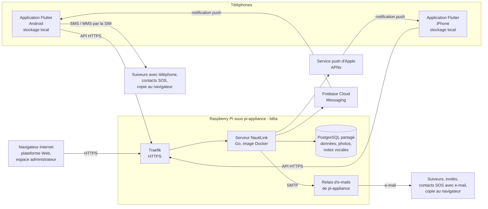

# NautiLink — Architecture technique

Ce document décrit comment les pièces techniques de NautiLink s'assemblent : applications, serveur, base de données, fichiers, e-mails, notifications push et SMS. La vue fonctionnelle (qui parle à qui, deux circuits indépendants, stockage local sur le téléphone) est au [§4 du cahier des charges](01-cahier-des-charges.md#4-architecture-générale) ; elle n'est pas recopiée ici. Les règles citées (`RG-…`) font foi ([02-regles-metier.md](02-regles-metier.md)).

- **Décidé** : chaque point porte la décision qui le fonde (`D-nn`, [07-decisions.md](07-decisions.md)).
- **Proposition validée** : choix proposé puis validé par l'utilisateur le 2026-11-25 ([D-96](07-decisions.md#d-96)).
- **Proposition, non validée** : choix technique proposé, à valider par l'utilisateur ([Q-22](06-questions-ouvertes.md#q-22)).

Mise à jour : 2026-11-25 (TODO-3.1, TODO-3.2, TODO-2.7).

## 1. Schéma

Tous les traits du schéma sont décidés (hébergement de la bêta).

## 2. Ce qui est décidé

| Pièce | Choix | Fondement |
|-------|-------|-----------|
| Applications mobiles | Flutter, un seul code pour Android et iPhone ; le même code donne la démonstration Web du prototype. | [D-58](07-decisions.md#d-58) |
| Application iPhone | Même code Flutter ; publication quand le compte développeur Apple sera ouvert. | [D-60](07-decisions.md#d-60) |
| Serveur | Serveur maison, pas de service tout fait ; écrit en Go ; un seul exemplaire qui porte l'API, la plateforme Web et l'espace administrateur sous un chemin réservé. Squelette dans [`server/`](../server/README.md) (TODO-3.7). | [D-59](07-decisions.md#d-59), [D-62](07-decisions.md#d-62) |
| Hébergement pendant la bêta | Raspberry Pi 4 de `vdl.moulard.org` sous pi-appliance, installé par « Docker Compose libre » ; adresse publique `https://nautilink.moulard.org`, redirigée par Traefik vers `https://vdl.moulard.org/nautilink/`. | [D-62](07-decisions.md#d-62) |
| Hébergement après la bêta | Passage chez un hébergeur avant l'ouverture au grand public ; hébergeur non choisi (§3.2). | [D-62](07-decisions.md#d-62) |
| Base de données | PostgreSQL partagé de pi-appliance pendant la bêta. | [D-62](07-decisions.md#d-62) |
| E-mails | Envoyés par le serveur via le relais d'envoi de pi-appliance pendant la bêta (invitations, accès, SOS, début de navigation, copie au navigateur). | [D-62](07-decisions.md#d-62), [D-10](07-decisions.md#d-10), [D-14](07-decisions.md#d-14), [D-41](07-decisions.md#d-41), [D-55](07-decisions.md#d-55) |
| SMS et MMS | Envoyés par la carte SIM du téléphone Android, sans prestataire ; SMS SOS et de positions automatiques envoyés automatiquement, autres SMS ordinaires préremplis ; pas de SMS depuis l'iPhone. | [D-48](07-decisions.md#d-48), [D-82](07-decisions.md#d-82), [D-32](07-decisions.md#d-32), RG-COM-01, RG-SMS-03 |
| Notifications push | Envoyées par le serveur : APNs pour l'iPhone, Firebase Cloud Messaging pour Android. Pour le suiveur sur iPhone : SOS, début, fin, nouvelle photo, position en retard ; contenu sur Android non décidé (§3.3). | [D-44](07-decisions.md#d-44), [D-86](07-decisions.md#d-86), RG-IOS-06 |
| Stockage des photos et notes vocales | Dans PostgreSQL (§3.1). | [D-86](07-decisions.md#d-86) |
| Photos | 20 par navigation au plus, environ 1 Mo chacune, envoyées au serveur ; le SMS peut donner un lien vers la photo hébergée. | [D-40](07-decisions.md#d-40), [D-49](07-decisions.md#d-49), RG-JRN-08, RG-SMS-05 |
| Notes vocales | AAC `.m4a`, 1 minute au plus, enregistrement seul, conservé sur le serveur ; le SMS donne un lien d'écoute sur la plateforme Web. | [D-53](07-decisions.md#d-53), [D-71](07-decisions.md#d-71), RG-JRN-04, RG-SMS-06 |
| Conservation et sauvegarde | Sauvegarde quotidienne gardée 30 jours : celle de pi-appliance pendant la bêta (§3.4) ; journaux techniques 1 an, d'administration 3 ans ; export JSON et GPX. | [D-46](07-decisions.md#d-46), [D-86](07-decisions.md#d-86), RG-DON-02 |
| Carte de la plateforme Web | Fond OpenStreetMap et balisage OpenSeaMap. | [D-79](07-decisions.md#d-79), RG-NAV-29 |

Risque accepté pendant la bêta : une coupure du Pi ou de la box arrête tout le circuit Internet, e-mails SOS compris ; les SMS partent quand même depuis Android ([D-62](07-decisions.md#d-62), RG-COM-01).

## 3. Ce qui n'est pas entièrement décidé

Les propositions ont été validées ([D-96](07-decisions.md#d-96)) ; ce qui reste ouvert est dans [Q-22](06-questions-ouvertes.md#q-22).

### 3.1 Stockage des photos et notes vocales

**Décidé** ([D-86](07-decisions.md#d-86)) : photos et notes vocales stockées dans PostgreSQL, comme les autres données ; elles sont donc couvertes par la même sauvegarde que la base (§3.4).

- Ordre de grandeur : au plus 20 Mo de photos par navigation (RG-JRN-08), et environ 0,5 Mo par minute de note vocale en AAC à 64 kbit/s ([étude](etudes/notes-vocales.md)).
- À préciser : comment s'ouvrent les liens envoyés par SMS (RG-SMS-05, RG-SMS-06) ; ce choix d'accès relève des règles : [Q-44](06-questions-ouvertes.md#q-44).

### 3.2 Hébergeur après la bêta

**Décidé plus tard** ([D-86](07-decisions.md#d-86)). **Proposition validée** ([D-96](07-decisions.md#d-96)) : un serveur virtuel chez un hébergeur situé dans l'Union européenne (RGPD, RG-DON-03), avec la même image Docker et un PostgreSQL dédié ; nom de domaine conservé (`nautilink.moulard.org` ou celui retenu en [Q-26](06-questions-ouvertes.md#q-26)). Hébergeur et date de passage à choisir.

### 3.3 Notifications push

**Décidé** ([D-86](07-decisions.md#d-86)) : le serveur Go envoie les notifications push par le service push d'Apple (APNs) pour l'iPhone, avec une clé du compte développeur Apple ([D-60](07-decisions.md#d-60)), et par Firebase Cloud Messaging (FCM), service de Google, pour Android.

- Notifications reçues par le suiveur sur Android : les mêmes que sur iPhone (RG-AND-08, [D-92](07-decisions.md#d-92)).

### 3.4 Sauvegardes

**Décidé** ([D-86](07-decisions.md#d-86)) : les sauvegardes de pi-appliance, chaque nuit, gardées 30 jours (RG-DON-02).

- Reste : vérifier qu'elles couvrent la base NautiLink (photos et notes vocales comprises, §3.1), puis faire un essai de restauration.

### 3.5 E-mails après la bêta

**Proposition validée** ([D-96](07-decisions.md#d-96)) : garder un relais d'envoi propre à l'hébergeur retenu, avec les enregistrements SPF, DKIM et DMARC du domaine de l'expéditeur, pour que les e-mails SOS n'arrivent pas en indésirables. À vérifier dès la bêta sur le relais de pi-appliance.

### 3.6 Services externes appelés par le serveur

- Météo marine : API de Météo-France ([D-88](07-decisions.md#d-88)) ; conditions d'accès (clé, quotas) à vérifier ([Q-39](06-questions-ouvertes.md#q-39)).
- Cartes du SHOM : [Q-23](06-questions-ouvertes.md#q-23).
- Géocodage inverse (nom du lieu, RG-NAV-16, RG-JRN-10) : Nominatim (OpenStreetMap), appelé par le serveur avec un cache des noms, en respectant sa limite d'usage ([D-96](07-decisions.md#d-96)).

## 4. API et synchronisation

**Proposition, non validée** ([Q-22](06-questions-ouvertes.md#q-22), TODO-3.2). Description complète : [`api/openapi.yaml`](api/openapi.yaml) (OpenAPI 3.1) ; chaque opération cite les règles qu'elle sert (`x-regles`), les traitements faits par le serveur seul sont listés dans `x-traitements`, et les règles sans échange avec le serveur dans `x-regles-sans-serveur`. Chaque règle `RG-…` figure dans l'une de ces trois listes.

- **Un seul point d'entrée** : `https://vdl.moulard.org/nautilink/api`, chemins versionnés `/v1/…` ; le point de santé `/api/sante` du squelette est gardé.
- **Formats** : JSON en UTF-8, heures RFC 3339 avec décalage horaire, positions en degrés décimaux WGS 84, durées en minutes, distances en mètres ; photos en JPEG et notes vocales en AAC (`audio/mp4`), déposées à part (`PUT /v1/fichiers/{evenementId}`).
- **Identifiants tirés par le téléphone** pour ce qu'il crée (navigation, événement, alerte SOS, contact ajouté hors connexion) : tout envoi peut être rejoué sans doublon (§5).
- **Sessions** : jeton porteur pour les applications mobiles, cookie pour la plateforme Web, cookie distinct pour l'espace administrateur (RG-ADM-01) ; durée : [Q-43](06-questions-ouvertes.md#q-43).
- **Synchronisation** :
  - téléphone → serveur : file d'attente (§5) ;
  - serveur → téléphone : contacts et paramètres généraux relus au lancement et après chaque modification quand Internet est disponible (RG-CTC-03, RG-PRM-02), avec un curseur `depuis` qui ne rend que les changements ; la dernière copie reçue sert hors connexion ;
  - serveur → Web : la page d'une navigation en cours relit le journal avec `depuis` à intervalles réguliers (de l'ordre de 30 secondes) ;
  - modifications concurrentes (même contact, mêmes paramètres ou même navigation changés sur deux supports) : chaque objet porte un numéro de version et une modification fondée sur une version dépassée est refusée (409) ; laquelle doit l'emporter : [Q-42](06-questions-ouvertes.md#q-42).
- **Points qui attendent une décision** : liens des SMS de photo et de note vocale ([Q-44](06-questions-ouvertes.md#q-44)) ; événements reçus après une clôture automatique ([Q-45](06-questions-ouvertes.md#q-45)) ; affichage des annonces ([Q-46](06-questions-ouvertes.md#q-46)) ; portée des désinscriptions du suiveur ([Q-47](06-questions-ouvertes.md#q-47)) ; fonctionnement hors connexion ([Q-29](06-questions-ouvertes.md#q-29)).

## 5. File d'attente et doublons

**Proposition, non validée** ([Q-10](06-questions-ouvertes.md#q-10), TODO-2.7). Les règles : enregistrement sur le téléphone que le serveur soit joignable ou non (RG-GPS-03), envoi dès que possible dans l'ordre d'acquisition (RG-GPS-04), fin transmise avec son heure réelle (RG-NAV-14), SOS de l'iPhone envoyé au retour de la connexion (RG-IOS-03).

- **Enregistrer d'abord** : chaque envoi vers le serveur (démarrage, événement, fichier de photo ou de note vocale, fin, alerte SOS, statuts des SMS SOS) est écrit dans la base locale du téléphone (SQLite) avant toute tentative ; une fermeture forcée ou un redémarrage ne le perd pas (RG-NAV-12).
- **Identifiant unique par événement** : l'application tire un UUID (version 4) à la création de la navigation, de chaque événement et de chaque alerte SOS, et l'envoie avec lui. Le serveur garde cet identifiant comme clé unique (contrainte d'unicité de PostgreSQL) :
  - identifiant inconnu : enregistré (201) ;
  - identifiant déjà reçu, même contenu : rien n'est créé, réponse 200 ;
  - identifiant déjà reçu, contenu différent : refus 409 `evenement_different` (défaut de l'application, inscrit dans les journaux techniques).
  Un envoi dont la réponse s'est perdue pendant une coupure est donc renvoyé sans risque de doublon.
- **Ordre** : chaque élément porte un numéro d'ordre croissant attribué par le téléphone pour la navigation (`numeroOrdre`) et son heure d'acquisition. La file part dans l'ordre des numéros ; le démarrage d'une navigation part avant ses événements et la fin après eux. Le journal est affiché selon l'heure d'acquisition (RG-JRN-03), si bien qu'un élément arrivé en retard prend tout de même sa place.
- **Priorités** : une alerte SOS part avant tout le reste, sans attendre la file ; puis les éléments légers (démarrage, positions, notes, fin) ; enfin les fichiers (photos, notes vocales), déposés à part pour qu'un gros fichier ne retarde jamais une position. Une photo ou une note vocale est visible sur le serveur dès son événement, son fichier suit.
- **Renvoi** : la file est relancée quand la connexion revient (changement de réseau signalé par le téléphone), à chaque nouvelle acquisition, à l'ouverture de l'application, et sinon après un délai croissant (30 secondes, 1, 2 et 5 minutes, puis toutes les 15 minutes). Après une coupure, elle part par lots (`POST /v1/synchronisation`, 200 éléments au plus) ; chaque élément a son propre résultat et un refus n'arrête pas les suivants.
- **Sortie de la file** : un élément quitte la file à la réponse 200 ou 201 seulement. Un refus définitif (autre code 4xx) le met de côté, sans nouvel essai, et le signale dans les journaux techniques du serveur au prochain échange ; une erreur du serveur (5xx) ou l'absence de réponse le laisse dans la file. La file n'a pas de limite de durée.
- **Chronomètre du dernier envoi** (RG-NAV-10) : un envoi réussi par le circuit Internet est une réponse 200 ou 201 du serveur.
- **Essai** : scénario TS-GPS-07 ([scénarios](tests/scenarios-fonctionnels.md)), à jouer sur un vrai téléphone avec 2 heures de coupure une fois l'application et le serveur écrits (TODO-5.3).

Environnements de développement, de test et de production : TODO-3.4.
