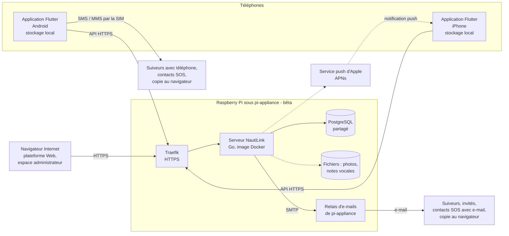

# NautiLink — Architecture technique

Ce document décrit comment les pièces techniques de NautiLink s'assemblent : applications, serveur, base de données, fichiers, e-mails, notifications push et SMS. La vue fonctionnelle (qui parle à qui, deux circuits indépendants, stockage local sur le téléphone) est au [§4 du cahier des charges](01-cahier-des-charges.md#4-architecture-générale) ; elle n'est pas recopiée ici. Les règles citées (`RG-…`) font foi ([02-regles-metier.md](02-regles-metier.md)).

- **Décidé** : chaque point porte la décision qui le fonde (`D-nn`, [07-decisions.md](07-decisions.md)).
- **Proposition (non validée)** : choix suggéré, repris dans [Q-22](06-questions-ouvertes.md#q-22). Ne pas l'implémenter tant que l'utilisateur ne l'a pas confirmé.

Mise à jour : 2026-11-25 (TODO-3.1).

## 1. Schéma

Les traits pleins sont décidés ; les traits pointillés sont des propositions non validées.

## 2. Ce qui est décidé

| Pièce | Choix | Fondement |
|-------|-------|-----------|
| Applications mobiles | Flutter, un seul code pour Android et iPhone ; le même code donne la démonstration Web du prototype. | [D-58](07-decisions.md#d-58) |
| Application iPhone | Même code Flutter ; publication quand le compte développeur Apple sera ouvert. | [D-60](07-decisions.md#d-60) |
| Serveur | Serveur maison, pas de service tout fait ; écrit en Go ; un seul exemplaire qui porte l'API, la plateforme Web et l'espace administrateur sous un chemin réservé. Squelette dans [`server/`](../server/README.md) (TODO-3.7). | [D-59](07-decisions.md#d-59), [D-62](07-decisions.md#d-62) |
| Hébergement pendant la bêta | Raspberry Pi 4 de `vdl.moulard.org` sous pi-appliance, installé par « Docker Compose libre » ; adresse publique `https://nautilink.moulard.org`, redirigée par Traefik vers `https://vdl.moulard.org/nautilink/`. | [D-62](07-decisions.md#d-62) |
| Hébergement après la bêta | Passage chez un hébergeur avant l'ouverture au grand public ; hébergeur non choisi (§3.2). | [D-62](07-decisions.md#d-62) |
| Base de données | PostgreSQL partagé de pi-appliance pendant la bêta. | [D-62](07-decisions.md#d-62) |
| E-mails | Envoyés par le serveur via le relais d'envoi de pi-appliance pendant la bêta (invitations, accès, SOS, début de navigation, copie au navigateur). | [D-62](07-decisions.md#d-62), [D-10](07-decisions.md#d-10), [D-14](07-decisions.md#d-14), [D-41](07-decisions.md#d-41), [D-55](07-decisions.md#d-55) |
| SMS et MMS | Envoyés par la carte SIM du téléphone Android, sans prestataire ; SMS SOS et de positions automatiques envoyés automatiquement, autres SMS ordinaires préremplis ; pas de SMS depuis l'iPhone. | [D-48](07-decisions.md#d-48), [D-82](07-decisions.md#d-82), [D-32](07-decisions.md#d-32), RG-COM-01, RG-SMS-03 |
| Notifications push | Pour le suiveur sur iPhone : SOS, début, fin, nouvelle photo, position en retard ; voie technique non choisie (§3.3). | [D-44](07-decisions.md#d-44), RG-IOS-06 |
| Photos | 20 par navigation au plus, environ 1 Mo chacune, envoyées au serveur ; le SMS peut donner un lien vers la photo hébergée. | [D-40](07-decisions.md#d-40), [D-49](07-decisions.md#d-49), RG-JRN-08, RG-SMS-05 |
| Notes vocales | AAC `.m4a`, 1 minute au plus, enregistrement seul, conservé sur le serveur ; le SMS donne un lien d'écoute sur la plateforme Web. | [D-53](07-decisions.md#d-53), [D-71](07-decisions.md#d-71), RG-JRN-04, RG-SMS-06 |
| Conservation et sauvegarde | Sauvegarde quotidienne gardée 30 jours ; journaux techniques 1 an, d'administration 3 ans ; export JSON et GPX. Emplacement des sauvegardes non choisi (§3.4). | [D-46](07-decisions.md#d-46), RG-DON-02 |
| Carte de la plateforme Web | Fond OpenStreetMap et balisage OpenSeaMap. | [D-79](07-decisions.md#d-79), RG-NAV-29 |

Risque accepté pendant la bêta : une coupure du Pi ou de la box arrête tout le circuit Internet, e-mails SOS compris ; les SMS partent quand même depuis Android ([D-62](07-decisions.md#d-62), RG-COM-01).

## 3. Ce qui n'est pas décidé : propositions (non validées)

Chacune de ces propositions est reprise dans [Q-22](06-questions-ouvertes.md#q-22).

### 3.1 Stockage des photos et notes vocales

**Proposition (non validée)** : fichiers sur disque, dans un volume Docker monté dans le conteneur du serveur (le conteneur est en lecture seule, [`server/compose.yaml`](../server/compose.yaml)) ; PostgreSQL ne garde que la description de chaque fichier (navigation, type, taille, date, empreinte). Le serveur sert les fichiers lui-même, après contrôle de l'accès. Après la bêta, le même modèle passe tel quel chez l'hébergeur, ou vers un stockage objet compatible S3 si le volume l'exige.

- Ordre de grandeur : au plus 20 Mo de photos par navigation (RG-JRN-08), et environ 0,5 Mo par minute de note vocale en AAC à 64 kbit/s ([étude](etudes/notes-vocales.md)).
- À préciser : comment s'ouvrent les liens envoyés par SMS (RG-SMS-05, RG-SMS-06) à un destinataire sans compte ; ce choix d'accès relève des règles, pas de l'architecture.
- Autres voies : fichiers dans PostgreSQL (sauvegarde unique, mais base plus lourde sur le Pi) ; stockage objet dès la bêta (service tiers, ce que D-59 écarte pour le serveur).

### 3.2 Hébergeur après la bêta

**Proposition (non validée)** : un serveur virtuel chez un hébergeur situé dans l'Union européenne (RGPD, RG-DON-03), avec la même image Docker et un PostgreSQL dédié ; nom de domaine conservé (`nautilink.moulard.org` ou celui retenu en [Q-26](06-questions-ouvertes.md#q-26)). Hébergeur et date de passage à choisir.

### 3.3 Notifications push

**Proposition (non validée)** : le serveur Go appelle directement le service push d'Apple (APNs), sans service intermédiaire, avec une clé du compte développeur Apple ([D-60](07-decisions.md#d-60)). L'application iPhone enregistre son jeton auprès du serveur à la connexion.

- À préciser : si l'application Android doit aussi recevoir des notifications push (les règles ne prévoient le push que pour le suiveur sur iPhone, RG-IOS-06), il faudrait Firebase Cloud Messaging, service de Google.

### 3.4 Sauvegardes

**Proposition (non validée)** : chaque nuit, une copie de la base (`pg_dump`) et des fichiers, gardée 30 jours (RG-DON-02), sur un support hors du Pi (autre machine ou espace distant), avec un essai de restauration avant l'ouverture de la bêta. À vérifier : ce que la sauvegarde de pi-appliance couvre déjà.

### 3.5 E-mails après la bêta

**Proposition (non validée)** : garder un relais d'envoi propre à l'hébergeur retenu, avec les enregistrements SPF, DKIM et DMARC du domaine de l'expéditeur, pour que les e-mails SOS n'arrivent pas en indésirables. À vérifier dès la bêta sur le relais de pi-appliance.

### 3.6 Services externes appelés par le serveur

- Météo marine : [Q-39](06-questions-ouvertes.md#q-39).
- Cartes du SHOM : [Q-23](06-questions-ouvertes.md#q-23).
- Géocodage inverse (nom du lieu, RG-NAV-16, RG-JRN-10) : **proposition (non validée)** : Nominatim (OpenStreetMap), appelé par le serveur avec un cache des noms, en respectant sa limite d'usage ; service à confirmer.

## 4. Suite

API et formats de données : TODO-3.2. Environnements de développement, de test et de production : TODO-3.4.
