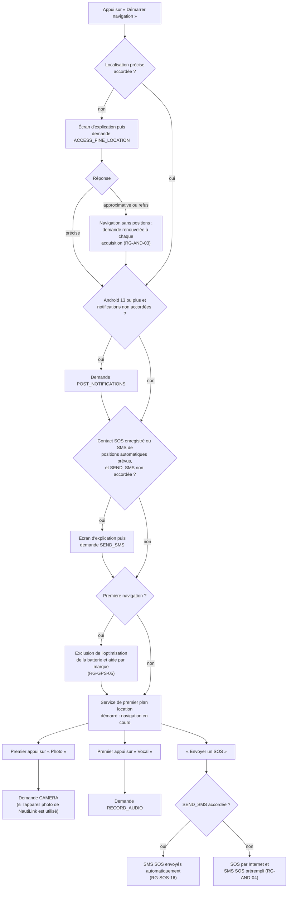

# Étude : autorisations Android et versions visées

Action : [TODO-2.3](../TODO.md) · Question : [Q-31](../06-questions-ouvertes.md#q-31) · Décisions prises en compte : [D-48](../07-decisions.md#d-48), [D-51](../07-decisions.md#d-51), [D-52](../07-decisions.md#d-52), [D-54](../07-decisions.md#d-54), [D-74](../07-decisions.md#d-74) · Règles : RG-GPS-05, RG-GPS-06, RG-NAV-12, RG-SMS-03, RG-SOS-16, RG-JRN-04.

**Statut : recherche documentaire (25 novembre 2026), sans essai sur téléphone.** Rien de ce document n'est une décision : la version minimale d'Android, l'ordre des demandes et le comportement en cas de refus sont des propositions, reportées dans [Q-31](../06-questions-ouvertes.md#q-31). Les pages d'aide Google Play (support.google.com) n'étaient pas joignables depuis l'environnement de rédaction : leurs liens sont donnés pour relecture, leur contenu vient des pages développeur Android qui y renvoient et des études [SMS et MMS](sms-mms-android.md) et [GPS en arrière-plan](gps-arriere-plan-android.md).

## 1. Repères de versions

| Repère | Valeur | Source |
|--------|--------|--------|
| Version visée exigée par Google Play (`targetSdk`) | Android 16 (API 36) pour les nouvelles applications et les mises à jour | [Target API level requirements](https://developer.android.com/google/play/requirements/target-sdk) (lue) |
| Valeurs par défaut de Flutter 3.47.9 (version du dépôt) | `minSdk` 24 (Android 7.0), `targetSdk` et `compileSdk` 36 | `FlutterExtension.kt` de Flutter 3.47.9 (lu) |
| Autorisations demandées à l'exécution | à partir d'Android 6.0 (API 23) ; avant, accordées à l'installation | [Request runtime permissions](https://developer.android.com/training/permissions/requesting) (lue) |

Versions où le comportement des autorisations change pour NautiLink : 8.0 (canaux de notification, `startForegroundService`), 10 (type de service `location`, localisation en arrière-plan séparée), 11 (« Toujours autoriser » seulement depuis les paramètres), 12 (position approximative au choix de l'utilisateur, alarmes exactes), 13 (notifications soumises à autorisation, sélecteur de photos), 14 (`FOREGROUND_SERVICE_LOCATION`, alarmes exactes refusées par défaut), 15 (démarrages au redémarrage restreints, sauf `location`).

## 2. Autorisations

Légende : **normale** = accordée à l'installation, sans boîte de dialogue ; **à l'exécution** = boîte de dialogue du système ; **spéciale** = réglage ouvert dans les paramètres du téléphone.

| # | Autorisation | Usage dans NautiLink | Type | Versions d'Android concernées | Règle Google Play |
|---|--------------|----------------------|------|-------------------------------|-------------------|
| 1 | `ACCESS_FINE_LOCATION` et `ACCESS_COARSE_LOCATION` | Positions automatiques, manuelles et SOS (RG-GPS-06) | à l'exécution | 6.0 et plus ; depuis 12, les deux sont demandées ensemble et l'utilisateur peut n'accorder que la position approximative (environ 3 km², inutilisable en mer) | Politique « Autorisations de localisation » (localisation au premier plan liée à la fonction principale) ; section « Sécurité des données » à remplir [P1] [P5] |
| 2 | `ACCESS_BACKGROUND_LOCATION` (« Toujours autoriser ») | **Non nécessaire** si la navigation démarre à l'écran et que la reprise après redémarrage se fait au lancement suivant (D-51) ; seule la reprise automatique au redémarrage l'exigerait ([étude GPS § 3](gps-arriere-plan-android.md#3-reprise-après-fermeture-forcée-ou-redémarrage-éclaire-d-51)) | à l'exécution, puis page des paramètres | 10 et plus ; depuis 11, accordée seulement depuis les paramètres, après la localisation au premier plan | Déclaration de localisation en arrière-plan dans la Play Console, vidéo et avertissement visible obligatoires [P1] |
| 3 | `FOREGROUND_SERVICE` et service de type `location` (`android:foregroundServiceType="location"`) | Service de premier plan qui garde la navigation active écran éteint, avec notification permanente | normale | `FOREGROUND_SERVICE` : 9 et plus ; type `location` déclaré : 10 et plus | Déclaration des types de services de premier plan dans la Play Console (applications visant Android 14 ou plus), avec description et vidéo [P2] [A1] |
| 4 | `FOREGROUND_SERVICE_LOCATION` | Même service | normale | 14 et plus ; exige aussi l'autorisation n° 1 accordée et la localisation activée | Même déclaration que n° 3 [P2] [A1] |
| 5 | `SEND_SMS` | SMS SOS envoyés automatiquement (RG-SOS-16, D-48). Les SMS ordinaires et les invitations s'ouvrent préremplis (RG-SMS-03) et ne demandent **aucune** autorisation | à l'exécution | 6.0 et plus | Politique « Groupes d'autorisations SMS et Journal d'appels » : réservée à l'application SMS par défaut, sauf exception accordée au cas par cas (ligne « urgence ») après la déclaration des autorisations [P3] ; voir l'[étude SMS § 1](sms-mms-android.md#1-ce-que-dit-google-play) |
| 6 | `CAMERA` | Bouton « Photo » | à l'exécution | 6.0 et plus. Si la photo est prise par l'application appareil photo du téléphone (`ACTION_IMAGE_CAPTURE`), l'autorisation n'est pas nécessaire ; mais si elle est déclarée et refusée, cet appel échoue | Pas de déclaration ; données « Photos » à déclarer dans « Sécurité des données » [P5] |
| 7 | Choix d'une photo existante (`READ_MEDIA_IMAGES` ou sélecteur de photos) | Ajout d'une photo de la galerie, si l'écran le prévoit | sélecteur : aucune ; `READ_MEDIA_IMAGES` : à l'exécution | Sélecteur natif : 11 et plus (et versions antérieures par Google Play) ; `READ_MEDIA_IMAGES` : 13 et plus | Politique « Autorisations d'accès aux photos et vidéos » : `READ_MEDIA_IMAGES` réservée aux applications dont c'est la fonction principale ; les autres utilisent le sélecteur [P4] [A2] |
| 8 | `RECORD_AUDIO` | Bouton « Vocal », 1 minute au plus, application à l'écran (RG-JRN-04) | à l'exécution | 6.0 et plus ; depuis 12, indicateur de micro affiché par le système | Pas de déclaration ; « Enregistrements audio » à déclarer dans « Sécurité des données » [P5] |
| 9 | `POST_NOTIFICATIONS` | Notification du service de navigation ; notification après redémarrage (RG-NAV-12, D-51) | à l'exécution | 13 et plus ; avant, accordée d'office. Refusée : le service tourne quand même, mais sa notification n'apparaît plus dans le volet, et la notification de reprise n'est pas affichée | Aucune règle propre [A3] |
| 10 | `REQUEST_IGNORE_BATTERY_OPTIMIZATIONS` (exclusion de l'optimisation de la batterie) | Demande au premier démarrage d'une navigation (RG-GPS-05, D-52) | normale ; la demande ouvre une boîte de dialogue du système (`ACTION_REQUEST_IGNORE_BATTERY_OPTIMIZATIONS`) | 6.0 et plus (Doze) | Demande directe acceptée par Google Play seulement si Doze empêche la fonction principale ; les applications de sécurité figurent parmi les cas acceptables. Sinon, ouvrir la liste des paramètres (`ACTION_IGNORE_BATTERY_OPTIMIZATION_SETTINGS`), sans autorisation [A4] |
| 11 | `RECEIVE_BOOT_COMPLETED` (redémarrage) | Afficher, après redémarrage, la notification qui invite à rouvrir la navigation en cours (D-51) ; ne démarre pas le service | normale | toutes ; depuis 15, certains types de service ne peuvent plus être démarrés à cette occasion (pas `location`), sans effet ici puisque seule une notification est affichée. Après « Forcer l'arrêt », rien n'est reçu jusqu'au lancement suivant | Aucune règle propre [A5] |
| 12 | `INTERNET`, `ACCESS_NETWORK_STATE` | Envois au serveur, file d'attente des envois | normale | toutes | Aucune |

### Points ouverts techniques, liés aux décisions déjà prises

- **Réveil entre deux positions (RG-GPS-06, D-74)** : si le GPS est éteint entre deux acquisitions, il faut réveiller l'application à l'heure de la position suivante. Les alarmes exactes demandent `SCHEDULE_EXACT_ALARM` (12 et plus, refusée par défaut depuis 14, réglage spécial) ou `USE_EXACT_ALARM`, que Google Play réserve aux réveils et agendas [P6] [A6]. En Doze, `setExactAndAllowWhileIdle()` ne se déclenche pas plus d'une fois toutes les 9 minutes, ce qui reste compatible avec la fréquence minimale de 15 minutes (RG-NAV-05). Autre voie : garder le service de premier plan actif et lui confier la minuterie, sans alarme exacte. À trancher avec l'architecture (TODO-3.1) et à mesurer au prototype de TODO-2.2.
- **Choix de la carte SIM pour le SMS SOS** : la SIM SMS par défaut (`SubscriptionManager.getDefaultSmsSubscriptionId()`) ne demande pas d'autorisation ; lister les SIM pour en choisir une demanderait `READ_PHONE_STATE`. Non décidé : à poser si les téléphones à deux SIM doivent être gérés.
- **Visibilité des applications (Android 11 et plus)** : pour vérifier qu'une application SMS existe avant d'ouvrir un SMS prérempli, déclarer `<queries>` pour l'intention `smsto:`. Pas une autorisation, mais à ne pas oublier.

## 3. Version minimale d'Android (décidée, D-80)

| Choix | Pour | Contre |
|-------|------|--------|
| **Android 8.0 (API 26)** — retenu (RG-AND-01) | Canaux de notification et `startForegroundService` présents partout ; aucune branche pour Android 7 ; reste compatible avec des téléphones anciens gardés à bord. | Quatre comportements différents à essayer (8–9, 10–12, 13, 14 et plus). |
| Android 7.0 (API 24) | Valeur par défaut de Flutter 3.47.9, public le plus large. | Pas de canal de notification ni de `startForegroundService` : cas particulier à coder et à essayer pour peu de téléphones. |
| Android 10 (API 29) | Type de service `location` et localisation en arrière-plan séparée partout ; moins de cas à essayer. | Exclut des téléphones encore en service ; part de ces téléphones à lire dans le tableau de répartition d'Android Studio avant de choisir. |

Version visée : Android 16 (API 36), imposée par Google Play (§ 1) ; elle n'est pas un choix.

## 4. Parcours de demande des autorisations

Principe décidé (RG-AND-02, D-80) : demander chaque autorisation **au moment où elle sert**, précédée d'un écran d'explication de NautiLink (exigé par Google Play pour les données sensibles [P5]) ; aucune demande au premier lancement ; une autorisation refusée est redemandée à chaque besoin. L'ordre ci-dessous reste une proposition non validée.

Remarques :

- La demande de `SEND_SMS` est placée au démarrage d'une navigation, et non au premier SOS, pour ne pas faire répondre à une boîte de dialogue pendant une urgence. Variante : à l'enregistrement du premier contact SOS.
- Une autorisation refusée deux fois n'est plus proposée par Android : pour la redemander (RG-AND-02), l'application envoie alors l'utilisateur dans ses paramètres [A7].
- `ACCESS_BACKGROUND_LOCATION` n'apparaît pas dans le parcours (n° 2 du § 2).

## 5. Reste à faire pour TODO-2.3

1. Relire les pages Google Play [P1] à [P6] (hôte support.google.com non joignable lors de la rédaction).
2. Tranché (D-80) : version minimale, demande au moment du besoin, refus de la localisation précise. Tranché (D-81) : refus de `SEND_SMS`, réveil entre deux positions. Reste à choisir ([Q-31](../06-questions-ouvertes.md#q-31)) : appareil photo de NautiLink ou du téléphone, SIM sur les téléphones à deux SIM, version minimale d'iOS.
3. Vérifier le parcours sur le prototype de TODO-2.2 (Android 8, 10, 13 et 14 au moins).

## Sources

Pages Google Play (non relues, hôte non joignable) :

- [P1] « Permissions de localisation » / « Accès à la localisation en arrière-plan » : https://support.google.com/googleplay/android-developer/answer/9799150
- [P2] « Exigences liées aux services de premier plan » : https://support.google.com/googleplay/android-developer/answer/13392821
- [P3] « Utilisation des groupes d'autorisations SMS ou Journal d'appels » : https://support.google.com/googleplay/android-developer/answer/10208820
- [P4] « Autorisations d'accès aux photos et vidéos » : https://support.google.com/googleplay/android-developer/answer/14115180
- [P5] « Données utilisateur » (avertissement visible) et « Sécurité des données » : https://support.google.com/googleplay/android-developer/answer/10144311 et https://support.google.com/googleplay/android-developer/answer/10787469
- [P6] « Autorisation d'alarme exacte » : https://support.google.com/googleplay/android-developer/answer/12253906

Pages développeur Android :

- [A1] Foreground service types : https://developer.android.com/develop/background-work/services/fgs/service-types
- [A2] Photo picker : https://developer.android.com/training/data-storage/shared/photopicker
- [A3] Notification runtime permission : https://developer.android.com/develop/ui/views/notifications/notification-permission
- [A4] Doze and App Standby : https://developer.android.com/training/monitoring-device-state/doze-standby
- [A5] Restrictions on starting a foreground service from the background : https://developer.android.com/develop/background-work/services/fgs/restrictions-bg-start
- [A6] Schedule exact alarms are denied by default (Android 14) : https://developer.android.com/about/versions/14/changes/schedule-exact-alarms
- [A7] Request runtime permissions : https://developer.android.com/training/permissions/requesting
- Location permissions : https://developer.android.com/training/location/permissions
