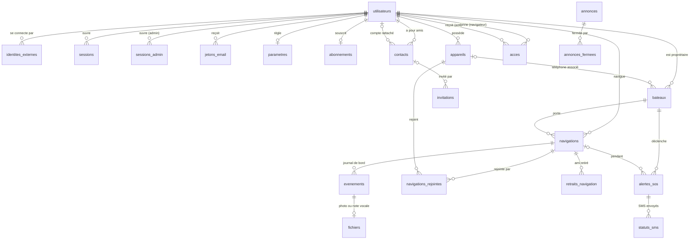

# Modèle de données

Description des données gardées par NautiLink : la base PostgreSQL du serveur central et la base locale SQLite du téléphone (TODO-2.75). Les règles citées (`RG-…`) font foi ([02-regles-metier.md](../02-regles-metier.md)) ; l'architecture d'ensemble est dans [08-architecture.md](../08-architecture.md), les formats échangés dans [docs/api/openapi.yaml](../api/openapi.yaml).

> **État** : rédigé le 2026-11-27 d'après le code : migrations 1 à 16 de `server/migrations.go` (serveur 0.x) et `app/lib/reel/base_locale.dart`. Ce document décrit l'existant ; il ne décide rien. Le code fait foi pour le détail des colonnes : une nouvelle migration doit être reportée ici dans le même commit.

## 1. Principes

- **Une seule base PostgreSQL**, sur pi-appliance pendant la bêta ([D-62](../07-decisions.md#d-62)). Le schéma est créé et mis à jour au démarrage du serveur par des migrations numérotées, appliquées une seule fois chacune (table `schema_migrations`), sous un verrou consultatif qui empêche deux serveurs de migrer en même temps. Une migration publiée n'est jamais modifiée : on en ajoute une à la fin, sans perte de données (ajout de table, de colonne, d'index, renommage).
- **Identifiants UUID.** Ceux des contacts, navigations, événements, alertes SOS et téléphones sont tirés par le téléphone (ou l'Application web) avant l'envoi : un renvoi depuis la file d'attente retombe sur la même ligne (`PUT` rejouables, [RG-COM-05](../02-regles-metier.md#rg-com-05), [08-architecture.md §5](../08-architecture.md#5-file-dattente-et-doublons)). Les autres (utilisateurs, bateaux, sessions, invitations, accès, annonces) sont tirés par la base (`gen_random_uuid()`).
- **Empreinte des envois** (`empreinte`, `bytea`) sur `navigations`, `evenements` et `alertes_sos` : condensé du contenu envoyé par le téléphone. Même identifiant et même empreinte : renvoi, accepté sans effet ; même identifiant et empreinte différente : conflit.
- **Curseur de synchronisation.** Une séquence unique `modifications` donne à chaque ligne modifiée de `contacts` et `evenements` un rang croissant (colonne `modification`) ; le téléphone demande « ce qui a changé depuis le rang N » ([RG-CTC-03](../02-regles-metier.md#rg-ctc-03), `POST /v1/synchronisation`).
- **Version** (`version`, entier) sur `contacts`, `parametres` et `navigations` : contrôle des modifications concurrentes (le client renvoie la version qu'il a lue).
- **Suppressions gardées** quand le téléphone doit les apprendre : `contacts.supprime_le` et `evenements.supprime_le` (la ligne reste, marquée, pour la synchronisation) ; `navigations.supprimee_le` pour la corbeille, restaurable 30 jours puis supprimée par la tâche de fond ([RG-NAV-20](../02-regles-metier.md#rg-nav-20), [RG-NAV-30](../02-regles-metier.md#rg-nav-30)).
- **Suppression d'un compte** : presque toutes les tables dépendent de `utilisateurs` en `ON DELETE CASCADE` ; les liens vers un autre compte (ami rattaché, invitation acceptée) passent à `NULL`.
- **Secrets** : seuls les empreintes SHA-256 des jetons de session et des liens envoyés par e-mail, et le hachage argon2id des mots de passe, sont gardés ([08-architecture.md §4](../08-architecture.md#4-api-et-synchronisation)). Le code d'accès à Météo-France (`reglages`) n'est jamais rendu par l'API ([RG-ADM-08](../02-regles-metier.md#rg-adm-08)).
- **Heures** en `timestamptz` (UTC). L'heure locale des messages vient du décalage du téléphone (`decalage_minutes`, [RG-PRM-07](../02-regles-metier.md#rg-prm-07)).
- **Anciens termes** : depuis la migration 16 ([D-188](../07-decisions.md#d-188)), plus aucune colonne ne porte *suiveur* ni *contact_sos*.

## 2. Vue d'ensemble

Tables sans lien : `lieux` (cache des noms de lieux), `journal_admin` (traces gardées même après suppression de l'administrateur), `reglages` (réglages du serveur), `schema_migrations`.

## 3. Tables du serveur

Les colonnes sont résumées ; « null » dit quand une colonne peut être vide et ce que cela signifie. Valeurs possibles entre accolades.

### 3.1 Comptes et sessions

| Table | Rôle | Colonnes principales | Règles |
|-------|------|----------------------|--------|
| `utilisateurs` | Un compte (navigateur et ami à la fois). | `email` unique ; `email_verifie_le` (null : pas vérifié) ; `mot_de_passe` (argon2id, vide pour un compte Google ou Apple seul) ; `nom` ; `telephone`, `recevoir_sms` ; `langue` {fr, en} ; préférences `emails_debut`, `push_debut`, `push_fin`, `push_photo`, `push_position_en_retard` ; `avertissement_version` et `avertissement_accepte_le` (avertissement bêta accepté). | RG-CPT, RG-PRM-03, RG-SMS-01 |
| `identites_externes` | Connexion Google ou Apple. | Clé (`fournisseur` {google, apple}, `sujet`) → `utilisateur_id`. | RG-CPT |
| `sessions` | Session d'un téléphone ou de l'Application web. | `jeton_acces`, `jeton_renouvellement` (empreintes, uniques) ; `support` {mobile, web} ; `appareil_id` (téléphone, sans clé étrangère) ; `derniere_utilisation` (expiration : 90 jours sur mobile, 1 heure sur le Web) ; `persistante` (« Rester connecté »). | RG-CPT-08, RG-CPT-12, D-160 |
| `jetons_email` | Liens envoyés par e-mail. | `jeton` (empreinte) ; `objet` {verification, mot_de_passe} ; `email` visé ; `expire_le` ; `utilise_le` (une seule utilisation). | RG-CPT |
| `parametres` | Paramètres généraux du compte. | Types de SMS envoyés (`sms_actifs`, `sms_debut`, `sms_positions_automatiques`, `sms_positions_manuelles`, `sms_notes`, `sms_photos`, `sms_notes_vocales`, `sms_incidents`, `sms_fin`), `photo_en_mms`, `frequence_par_defaut` ; chaque colonne null : jamais réglée (valeur par défaut d'un nouveau compte) ; `version`. | RG-PRM-06, RG-JRN-11 |
| `abonnements` | Abonnement en cours, un seul par compte quel que soit le canal. | `canal` {google_play, app_store, stripe} ; `debut`, `fin` ; `reference` de la transaction. | RG-ECO-06, RG-ECO-07 |

### 3.2 Téléphones et bateaux

| Table | Rôle | Colonnes principales | Règles |
|-------|------|----------------------|--------|
| `appareils` | Téléphone d'un utilisateur, identifiant tiré par l'application. | `plateforme` {android, ios} ; `nom` (modèle) ; `jeton_push` (APNs ou FCM, null : pas de notification) ; `version_application`. | RG-NOT |
| `bateaux` | Bateau et sa fiche. | `proprietaire_id` ; `nom` ; `type` {voilier, moteur} ; `longueur_metres`, `immatriculation`, `port_attache`, `moteur`, `autonomie`, `capacite_carburant_litres`, `vitesse_noeuds`, `tirant_eau_metres` ; `photo` (dans la base) ; `appareil_associe_id` (téléphone associé, null si le téléphone est supprimé). | RG-BAT |

### 3.3 Amis, invitations, accès

| Table | Rôle | Colonnes principales | Règles |
|-------|------|----------------------|--------|
| `contacts` | Ami d'un navigateur (sa liste). | `navigateur_id` ; `nom`, `telephone`, `email` ; `invite` (ami invité dont l'accès n'est pas retiré) ; `avec_telephone` (ancienne case, remplie par « a un numéro », ne sert plus) ; `perimetre` {navigation, navigateur} et `navigation_id` ; `utilisateur_id` (compte de l'ami une fois l'invitation acceptée) ; `creee_le` (SOS : ami ajouté après le démarrage, RG-SOS-21) ; `version`, `modification`, `supprime_le`. | RG-CTC, RG-PAR-02, D-186, D-188 |
| `invitations` | Invitation envoyée à un ami. | `contact_id` ; `canal` {email, telephone} ; `email`, `telephone` ; `perimetre`, `navigation_id` ; `jeton` (dans le lien) ; `etat` {envoyee, acceptee, annulee} ; `acceptee_le`, `acceptee_par`. Une nouvelle invitation annule la précédente du même contact. | RG-PAR, RG-CPT-09 |
| `acces` | Droit d'un ami à voir les navigations d'un navigateur. | `navigateur_id`, `ami_id` ; `perimetre` {navigateur : toutes ses navigations ; navigation : une seule, `navigation_id`} ; `contact_id`. Un seul accès par (navigateur, ami, navigation). | RG-PAR-02 |
| `retraits_navigation` | Ami retiré d'une seule navigation, alors qu'il garde l'accès de périmètre navigateur. | Clé (`navigation_id`, `ami_id`). | RG-PAR |

### 3.4 Navigations et journal de bord

| Table | Rôle | Colonnes principales | Règles |
|-------|------|----------------------|--------|
| `navigations` | Une navigation. En cours tant que `fin_enregistree` est vide. | `navigateur_id`, `bateau_id` ; `appareil_id` (téléphone qui l'a démarrée, null : démarrée sur le Web, RG-WEB-06) ; `nom`, `destination` (JSON) ; `frequence_minutes` ; `parametres` (JSON : types de SMS de cette navigation) ; `personnes_a_bord` ; `personnes_alertees` (contacts cochés « E-mail », RG-NAV-25) ; `chef_de_bord` (null : le navigateur, RG-NAV-36) ; heures enregistrées par le téléphone (`debut_enregistre`, `fin_enregistree`) et heures affichées, modifiables (`debut`, `fin`) ; `meteo_depart`, `meteo_arrivee` (JSON) ; `epuise_le` (quota épuisé) ; `cloture_automatique_le` ; `retard_push_le` (position en retard déjà notifiée, D-84) ; `decalage_minutes` ; `supprimee_le` (corbeille) ; `empreinte`, `version`. | RG-NAV, RG-ECO, RG-IOS-06 |
| `navigations_rejointes` | Autres téléphones du compte qui ont rejoint la navigation. | Clé (`navigation_id`, `appareil_id`). | RG-NAV-39 |
| `evenements` | Ligne du journal de bord. | `type` {debut, position_automatique, position_manuelle, note, photo, note_vocale, sos, fin, ajout, incident} ; `heure_acquisition` (heure du téléphone) ; `numero_ordre` (tiré par le téléphone) ; position : `latitude`, `longitude`, `precision_metres`, `heure_position`, `gps_disponible` ; `lieu` et `lieu_cherche` (nom trouvé par la tâche de fond) ; `texte` ; fichier attendu : `fichier_type`, `fichier_taille`, `fichier_duree` ; `origine` {android, ios, web} ; `alerte_sos_id` ; `empreinte`, `recu_le`, `modification`, `supprime_le`. | RG-JRN, RG-GPS, RG-JRN-07, RG-JRN-11 |
| `fichiers` | Contenu d'une photo (`image/jpeg`) ou d'une note vocale (`audio/mp4`), envoyé à part de l'événement. | `evenement_id` (clé) ; `type_media` ; `contenu` (dans la base, [08-architecture.md §3.1](../08-architecture.md#31-stockage-des-photos-et-notes-vocales)). | RG-JRN-04 |
| `lieux` | Cache des noms de lieux (géocodage inverse). | Clé (`latitude`, `longitude`) en millièmes de degré arrondis (environ 100 m) ; `nom` (null : rien trouvé). | — |

### 3.5 SOS

| Table | Rôle | Colonnes principales | Règles |
|-------|------|----------------------|--------|
| `alertes_sos` | Alerte SOS reçue par le serveur. | `navigateur_id`, `bateau_id`, `navigation_id` (null : hors navigation ou navigation supprimée), `appareil_id` ; `heure_declenchement` ; position et `nature_position` {actuelle, derniere_connue, aucune} ; `probleme`, `personnes_a_bord` ; `emails_envoyes_a` ; `decalage_minutes` ; `empreinte`, `recue_le`. | RG-SOS, RG-SOS-09 à RG-SOS-11 |
| `statuts_sms` | Statut de chaque SMS SOS envoyé par le téléphone. | Clé (`alerte_id`, `telephone`, `rang`) ; `contact_id` ; `statut` {en_attente, accepte_pour_envoi, livraison_confirmee, echec} ; `essais`. | RG-SOS |

### 3.6 Administration

| Table | Rôle | Colonnes principales | Règles |
|-------|------|----------------------|--------|
| `sessions_admin` | Session de l'espace administrateur, distincte de celle de l'utilisateur. | `jeton` (empreinte) ; `derniere_utilisation` ; `persistante`. | RG-ADM-01, RG-ADM-07 |
| `journal_admin` | Trace de chaque action d'un administrateur, gardée 3 ans. | `le` ; `admin_id`, `admin_email` ; `action` ; `ressource` ; `cible` ; `details` (JSON). | RG-ADM-03, RG-DON-02 |
| `annonces` | Annonce en bandeau. | `texte` ; `fin_le` (null : sans fin) ; `creee_par`. | RG-ADM-06 |
| `annonces_fermees` | Annonce fermée par un utilisateur. | Clé (`annonce_id`, `utilisateur_id`). | RG-ADM-06 |
| `reglages` | Réglages du serveur posés dans l'espace administrateur. | Clé `cle` (aujourd'hui `meteofrance`) ; `valeur` ; `modifie_par`. | RG-ADM-08 |

## 4. Contraintes notables

- **Une navigation en cours par bateau et par téléphone** : index uniques partiels `navigations (bateau_id) WHERE fin_enregistree IS NULL` et `navigations (appareil_id) WHERE fin_enregistree IS NULL`.
- **Un accès par ami et par navigation** : index unique `acces (navigateur_id, ami_id, coalesce(navigation_id, 0…0))` (l'accès de périmètre navigateur compte une fois).
- **Recherches fréquentes indexées** : navigations d'un navigateur par date, journal d'une navigation par heure et par rang de modification, événements dont le lieu reste à chercher, alertes SOS d'un bateau par date, contacts d'un navigateur par rang de modification.
- **Identifiants sans clé étrangère** : `sessions.appareil_id`, `navigations.appareil_id`, `alertes_sos.appareil_id`, `contacts.navigation_id`, `invitations.navigation_id`, `acces.navigation_id`, `evenements.alerte_sos_id` et `statuts_sms.contact_id` ne sont pas liés par la base. L'identifiant peut arriver avant la ligne visée (file d'attente du téléphone) ou lui survivre ; la purge de la corbeille retire elle-même les accès de périmètre navigation.

## 5. Conservation et purge

| Donnée | Durée | Par |
|--------|-------|-----|
| Navigations, journaux, positions, fichiers | Sans limite, sauf suppression ([RG-DON-01](../02-regles-metier.md#rg-don-01), [RG-DON-02](../02-regles-metier.md#rg-don-02)) | — |
| Navigation dans la corbeille | 30 jours, puis suppression définitive (cascade sur le journal et les fichiers) | Tâche de fond `purgerLaCorbeille` |
| Journal d'administration | 3 ans ([RG-DON-02](../02-regles-metier.md#rg-don-02)) | — |
| Sauvegarde de la base | Quotidienne, gardée 30 jours ([08-architecture.md §3.4](../08-architecture.md#34-sauvegardes)) | Hors du serveur |

Les autres tâches de fond qui écrivent dans la base : clôture automatique des navigations, nom des lieux, relance des e-mails SOS en échec, notification des positions en retard, relevés météo (`server/taches.go`).

## 6. Base locale du téléphone

Base SQLite (`nautilink.db`, paquet `sqflite`) sur Android et iPhone ; en mémoire pour les essais et l'Application web de démonstration. Elle sert hors connexion ([RG-COM-06](../02-regles-metier.md#rg-com-06)) : rien n'y est la référence, le serveur fait foi une fois l'envoi reçu.

| Table | Rôle | Colonnes |
|-------|------|----------|
| `file_attente` | Envois enregistrés avant toute tentative ([RG-COM-05](../02-regles-metier.md#rg-com-05)). | `sequence` (ordre d'enregistrement) ; `cle` unique (`operation:id`, une opération par identifiant) ; `operation` {demarrage, evenement, fin, alerte_sos, statuts_sms, fichier} ; `id`, `navigation_id` ; `contenu` (corps JSON de l'appel) ; `priorite` (0 SOS, 1 éléments légers, 2 fichiers) ; `essais`, `mis_de_cote` (refus définitif 4xx, gardé sans nouvel essai), `dernier_statut`, `derniere_erreur` ; `chemin` et `type_media` du fichier ; `cree_le`. |
| `numeros_ordre` | Dernier numéro d'ordre tiré par navigation (1, 2, 3…). | `navigation_id`, `dernier`. |
| `copies` | Dernières réponses du serveur, rendues hors connexion avec leur heure. | `cle`, `valeur` (JSON), `recue_le`. Clés : `profil`, `navigations`, `bateaux`, `contacts` et `contacts.curseur` (rang de synchronisation), `parametres`, `quota`, `alertes`, `annonces`, `actualise`, `navigation_locale` (navigation en cours sur ce téléphone), `compte.enAttente`. |

Changer de compte efface les copies, pas la file d'attente (la déconnexion ne vide pas la file, [RG-CPT-08](../02-regles-metier.md#rg-cpt-08)). Les jetons de session sont gardés à part, dans les préférences de l'application ([RG-CPT-12](../02-regles-metier.md#rg-cpt-12)).

L'Application web ne garde rien sur l'ordinateur en dehors du cookie de session : ses pages sont rendues par le serveur.
